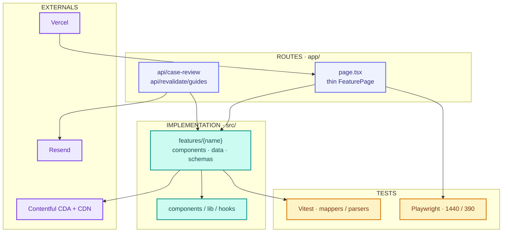
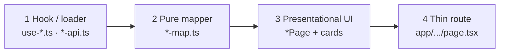
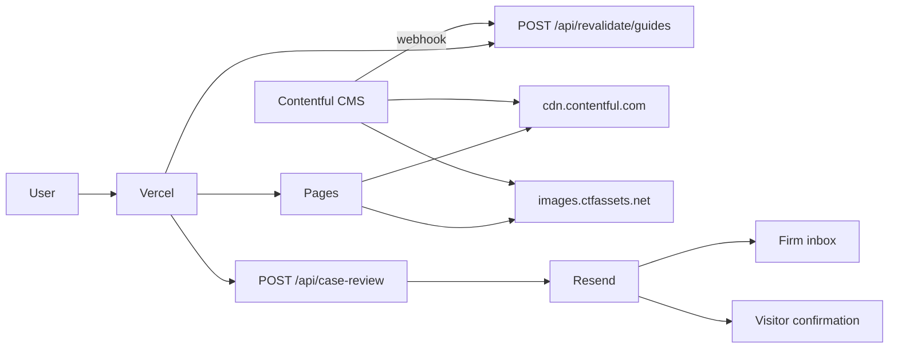
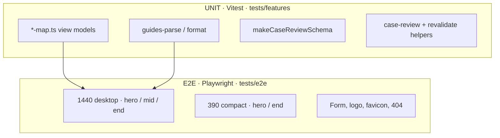

<div align="center">
  <h3 align="center">Olive Legal Group</h3>
  <p>Marketing site for a California / Nevada trial firm. Next.js 16, feature modules, Contentful guides, Figma-locked Playwright.</p>
  <p>
    <a href="https://kanopy-trial.vercel.app/"></a>
    
    
    
    
  </p>
</div>

**Live:** [https://kanopy-trial.vercel.app/](https://kanopy-trial.vercel.app/)

## Table of contents

1. [What this is](#what-this-is)
2. [Quick start](#quick-start)
3. [Routes](#routes)
4. [Architecture](#architecture)
5. [Approaches](#approaches)
6. [External integrations](#external-integrations)
7. [Testing](#testing)
8. [Performance](#performance)
9. [Naming](#naming)
10. [Adding a feature](#adding-a-feature)
11. [Scripts](#scripts)
12. [Tooling](#tooling)

## What this is

Public marketing site for Olive Legal Group (personal injury, lemon law, workers’ compensation). Routes stay thin. Domain work lives in `src/features`. Shared UI lives in `src/components`. Tests sit in `tests/` and mirror `src/`.

Stack: **Next.js 16** App Router, **React 19**, **TypeScript**, **Tailwind v4**, **Zod + React Hook Form**, **Vitest**, **Playwright**. Node **≥ 20.9** / npm **≥ 10** (`.nvmrc` is `lts/iron`).

Imports use `@/` (`src/*`). Styling is Tailwind tokens only — no CSS modules, no arbitrary values.

## Quick start

```bash
npm install
cp .env.example .env.local   # fill Resend + Contentful keys
npm run prepare
npm run dev
```

Open [http://localhost:3000](http://localhost:3000).

| Need | Command |
| --- | --- |
| Unit tests | `npm run test:run` |
| E2E (Figma lock) | `npm run test:e2e` |
| Production | `npm run build && npm start` |

### Environment

| Variable | Used for |
| --- | --- |
| `RESEND_API_KEY` | Case-review lead + confirmation email |
| `CASE_REVIEW_FROM` | From address |
| `CASE_REVIEW_INBOX` | Inbox that receives the lead |
| `CONTENTFUL_SPACE_ID` | Guides CDA space (`p8ewnz88avrp`) |
| `CONTENTFUL_ENVIRONMENT` | Usually `master` |
| `CONTENTFUL_ACCESS_TOKEN` | Content Delivery API token |
| `CONTENTFUL_REVALIDATE_SECRET` | Webhook header `x-revalidate-secret` |

Never commit `.env.local`.

## Routes

| Path | Feature | Data |
| --- | --- | --- |
| `/` | Home | Static copy + case-review form |
| `/personal-injury` | Practice | Static copy |
| `/lemon-law` | Practice | Static copy |
| `/workers-comp` | Practice | Static copy |
| `/results` | Results | Static copy |
| `/about` | About | Static copy |
| `/contact` | Contact | Static copy; form success → `/thanks` |
| `/thanks` | Thanks | Query (`name`, `phone`) |
| `/guides` | Guides listing | Contentful `guide` entries |
| `/guides/[slug]` | Guide article | Same CDA collection, ISR |
| unmatched | `app/not-found.tsx` | Static 404 |

Home form stays on the page and toasts. Contact form is the only path that navigates to Thanks.

## Architecture

```
app/                         routes only (thin page.tsx)
  api/case-review/           POST lead (Zod + Resend + cooldown)
  api/revalidate/guides/     POST Contentful webhook
src/
  features/<domain>/
    components/              *Page + section cards
    data/                    use-*.ts, *-map.ts, *-api.ts, copy
    schemas/                 Zod factories (case review)
  components/{ui,layout,feedback,media}
  lib/                       site-media, http, utils
  hooks/                     Zustand UI chrome only
  styles/                    tokens.css, type.css, globals.css
tests/
  features/                  mapper / schema / API unit tests
  e2e/                       Figma pixel + flow specs
```



### Three-layer data flow

Every feature follows the same path. Components never fetch. Hooks never map.



1. Load in `data/use-*.ts` (or `*-api.ts` for server fetch).
2. Map DTOs → view models in `data/*-map.ts` (no React, no I/O).
3. Render the view model in feature components.
4. Re-export from `app/.../page.tsx`.

**Guides** is the live example: `loadGuideEntries()` → `toGuidesView` / `toGuideArticleView` → `GuidesPage` / `GuideArticlePage`.

### State ownership

| State | Owner |
| --- | --- |
| Guides topic filter | Local state in `GuidesFeed` |
| Server data / ISR | Feature loaders + tagged `fetch` |
| Form values / validation | React Hook Form + `make*Schema(t)` |
| Cross-route chrome (sidebar) | Zustand `useUiStore` |
| Case-review cooldown | Server memory keyed by client |

API data is not copied into Zustand. Form state is not stored in the client store. No PII in `localStorage`.

### Layout and design system

- Figma competitor-clone frames are the source of truth. Desktop canvas is **1440**. Compact breakpoint is **`--breakpoint-compact: 1000px`**. Phone specs use **390**.
- `page-zoom` scales the 1440 canvas: `zoom: max(1, 100vw / 1440)`. At 1440, zoom is `1`.
- Tokens live in `src/styles/tokens.css` (`pine`, `paper`, `footer`, spacing, type). No `px-[10px]` / `text-[#fff]`.
- Type: **Jost** (UI) and **Fraunces** (headings) via `next/font`.
- Shared chrome: `HomeHeader`, `HomeFooter`, `ClosingCta`, `CaseReviewForm`, `SiteLogo`, `AppImage`.
- Source files stay **≤ 120 lines**. Split a page into a thin shell plus per-card components.

## Approaches

**Feature folders.** One domain per folder (`home`, `guides`, `contact`, …). Shared code only in `src/components`, `src/lib`, `src/hooks`.

**Design-to-code.** Implement from Figma, then lock spacing/type/copy with Playwright (`tests/e2e/*-figma-spec.ts`). Desktop 1440 and compact 390 are both specified.

**Mapper-first (TDD for data).** View-model tests are written against `*-map.ts` and parsers with no network. UI receives already-shaped props. Contentful parse/map tests fail in isolation if a DTO shape changes.

**CDN, not `/public`.** Static photos, logos, and the favicon live in Contentful. `SITE_MEDIA` in `src/lib/site-media.ts` holds the `images.ctfassets.net` URLs. `AppImage` is `next/image` with `unoptimized` so the browser hits the CDN directly.

**ISR for guides.** CDA `fetch` uses `cache: 'force-cache'` and `next: { tags: ['guides'] }`. A Contentful webhook POSTs `/api/revalidate/guides` with `x-revalidate-secret`. The handler calls `revalidateTag('guides', { expire: 0 })` plus `revalidatePath` for `/guides` and `/guides/[slug]`.

**Surgical forms.** One Zod factory (`makeCaseReviewSchema`). Home toasts on success. Contact `router.push`es `/thanks`. Rate limit returns `429` + `Retry-After`.

**Absolute imports only** (`@/…`). Named exports in `src/`. `export default` only in `app/`.

## External integrations



### Contentful

- Space `p8ewnz88avrp`, environment `master`, locale `en-US`.
- Content type `guide`: slug, title, deck, category, publishedAt, readMinutes, author, featured, hero image, lead, sections.
- Listing and article both read `GET /spaces/{id}/environments/{env}/entries?content_type=guide&include=2`.
- Images: `https://images.ctfassets.net/p8ewnz88avrp/...` (allowed in `next.config.mjs` `remotePatterns`).
- Webhook: `POST /api/revalidate/guides` header `x-revalidate-secret`.

### Resend

`POST /api/case-review` validates with Zod, then `deliverCaseReview`:

1. Lead email to `CASE_REVIEW_INBOX`.
2. Confirmation to the visitor if they left an email.

### Vercel

Production: [https://kanopy-trial.vercel.app/](https://kanopy-trial.vercel.app/). Set the same env vars in the Vercel project. Preview deploys inherit the App Router + ISR tag path.

### Figma (design only)

Frames are implemented at 1440 and 390. Figma is not a runtime dependency.

## Testing

Two layers, both required. Unit tests lock data. E2E locks the Figma frame.



**Mapper-first TDD (unit)**

1. Red: write `toXView` / `parseGuideEntry` expectations against a fixture (no HTTP).
2. Green: implement the mapper or parser.
3. Refactor: keep files under 120 lines; do not merge look-alike helpers.

Current suite: **60 unit tests / 30 files**, `vitest run` ~2s.

**Design-lock TDD (e2e)**

1. Capture Figma numbers in `*-figma-spec.ts` (padding, type, copy, photo size).
2. Implement the page against those tokens.
3. Playwright asserts computed styles and copy at **1440×900** and **390×844**.

54 spec files under `tests/e2e`. Guides e2e read **live Contentful** entries (the four published posts), not a local seed.

```bash
npm test              # Vitest watch
npm run test:run      # Vitest CI
npm run test:e2e      # Playwright (starts or reuses :3000)
```

Playwright uses `PLAYWRIGHT_BROWSERS_PATH` if you keep browsers in `~/Library/Caches/ms-playwright`.

## Performance

Measured against [https://kanopy-trial.vercel.app/](https://kanopy-trial.vercel.app/) (HTML document only, `curl`, 3 samples). First Guides/article hit is a cold ISR path; later hits are tagged-cache.

| Route | Status | TTFB avg | Total avg | HTML bytes | Notes |
| --- | --- | --- | --- | --- | --- |
| `/` | 200 | 234 ms | 279 ms | 113 KB | Static page |
| `/contact` | 200 | 322 ms | 367 ms | 58 KB | First 517 ms, then ~222 ms |
| `/guides` | 200 | 347 ms | 391 ms | 48 KB | First 590 ms, then ~222 ms |
| `/guides/no-problem-found` | 200 | 409 ms | 455 ms | 55 KB | First 772 ms, then ~223 ms |

Warm TTFB on all four sits around **220–230 ms**.

**Why it stays small**

- Guides HTML is the mapped view model only. Photos are not inlined.
- `images.unoptimized: true` — no `/_next/image` hop; the browser loads Contentful CDN (CloudFront, `max-age=31536000`).
- `AppImage` sets `loading="eager"` / `fetchPriority="high"` on above-the-fold photos.
- Duplicate files share one asset (grove/Henderson, attorneys/Irvine, lemon shop/featured).
- Fonts via `next/font` (Jost, Fraunces). No extra webfont CSS.
- ISR tag `guides` + `revalidateTag(..., { expire: 0 })` so a CMS publish does not wait on a TTL.

These numbers are document timings, not Lighthouse. Re-run from your region before quoting them in a report.

## Naming

| Kind | Pattern | Example |
| --- | --- | --- |
| Components | PascalCase, named export | `GuidesPage.tsx` |
| Data / lib / hooks | kebab-case | `use-guides.ts`, `guides-map.ts` |
| Mappers | `to*` | `toGuidesView` |
| Zod factories | `make*Schema(t)` | `makeCaseReviewSchema` |
| Formatters | `format*` | `formatGuideDate` |
| Tests | same path under `tests/` | `tests/features/guides/guides-map.test.ts` |
| Commits | `<type>: <lowercase summary>` | `feat: wire guides from contentful` |
| Imports | `@/` only | `import { AppImage } from '@/components/media/AppImage'` |

## Adding a feature

1. Create `src/features/<name>/{data,components}`.
2. Add `something-map.ts` and `use-something.ts`.
3. Add `SomethingPage.tsx` (named export). Keep each file ≤ 120 lines.
4. Add `app/<route>/page.tsx`:

```tsx
import { SomethingPage } from '@/features/<name>/components/SomethingPage';

export default function Page() {
  return <SomethingPage />;
}
```

5. Add mapper tests under `tests/features/<name>/` and a Figma e2e pair (`*-hero`, `*-end`, plus `*-mobile` if the frame exists).

Shared chrome goes in `src/components/{ui,layout,feedback,media}`, not in the feature.

## Scripts

| Script | Purpose |
| --- | --- |
| `npm run dev` | Next.js + inspector |
| `npm run build` / `start` | production |
| `npm run lint` | ESLint |
| `npm run prettier` | format (do not `--write` a glob; repo is CRLF) |
| `npm run prepare` | Husky |
| `npm run test` / `test:run` | Vitest |
| `npm run test:e2e` | Playwright |

## Tooling

- **Husky** — `lint-staged` (eslint --fix) on commit; `npm run build` on push; commitlint on commit-msg (`feat:`, `fix:`, `refactor:`, …).
- **Commitlint** — header ≤ 100 chars, lowercase subject, no trailing period.
- **Prettier** — format on save. Do not run `--write` on a glob (rewrites CRLF).
- **VS Code** — Next.js debug configs in `.vscode/launch.json`.
