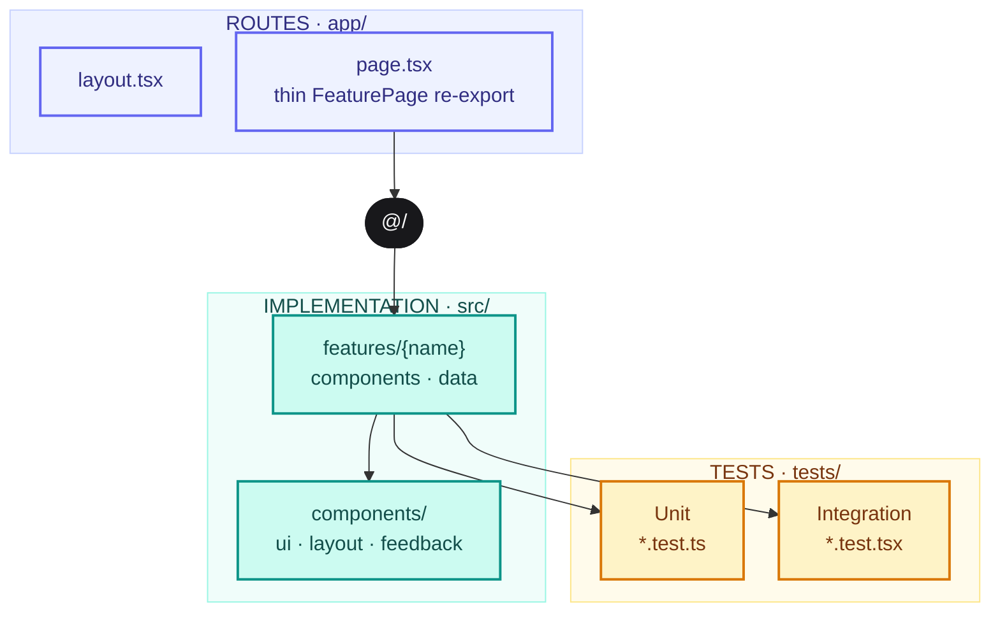
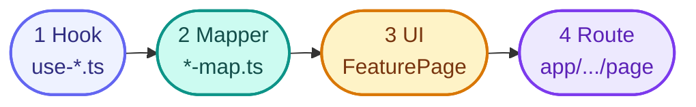
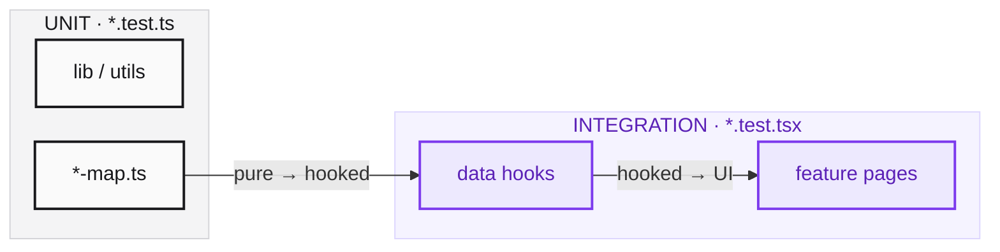

<div align="center">
  <h3 align="center">Platformz Next.js Starter</h3>
  <p>Feature modules and Vitest.</p>
  <p>
    
    
    
  </p>
</div>

## Table of contents

1. [What this is](#what-this-is)
2. [Quick start](#quick-start)
3. [Architecture](#architecture)
4. [Naming](#naming)
5. [Feature data flow](#feature-data-flow)
6. [Testing](#testing)
7. [Adding a feature](#adding-a-feature)
8. [Scripts](#scripts)
9. [Tooling](#tooling)

## What this is

A Next.js 16 App Router starter (React 19). Routes stay thin. Domain work lives in `src/features`. Shared UI lives in `src/components`. Tests sit in `tests/` and mirror `src/`.

Imports use `@/` (`src/*`). Styling is Tailwind only — no CSS modules.

## Quick start

Requires Node **20.9+** (`lts/iron` in `.nvmrc`).

```bash
git clone git@github.com:PlatformzHQ/platformz-next-template.git
cd platformz-next-template
npm install
npm run prepare
npm run dev
```

Open [http://localhost:3000](http://localhost:3000).

| Need | Command |
| --- | --- |
| Tests | `npm run test:run` |

## Architecture

```
app/                         Next.js routes (thin)
src/
  features/<name>/           domain
    components/              PascalCase screens
    data/                    use-*.ts, *-map.ts
  components/
    ui/                      shared primitives
    layout/                  layout shells
    feedback/                loaders, toasts
  lib/  hooks/  data/        shared helpers
tests/                       mirrors src/
```



Pages import from `@/features/...` and render a feature component. They do not fetch data themselves.

## Naming

| Kind | Pattern | Example |
| --- | --- | --- |
| React components | PascalCase, named export | `Loader.tsx` → `export function Loader` |
| Feature screens | PascalCase `*Page.tsx` | `CommandCenterPage.tsx` |
| Hooks / mappers / lib | kebab-case | `use-hello.ts`, `hello-map.ts` |
| Tests | same path under `tests/` | `tests/features/example/hello-map.test.ts` |
| Imports | `@/` only | `import { Loader } from '@/components/feedback/Loader'` |

## Feature data flow



1. Fetch or compose data in `data/use-*.ts`.
2. Map the payload to a view model in `data/*-map.ts`.
3. Render that view model in a feature component.
4. Re-export the component from a thin `app/.../page.tsx`.

## Testing



- `tests/` mirrors `src/`.
- Unit: pure functions, no network. Extend `tests/lib/utils.test.ts`.
- Integration: hooks and feature pages. Use `tests/utils/render.tsx` (`renderWithProviders`).
- Helpers: `tests/setup.ts`, `tests/utils/render.tsx`.

```bash
npm test           # watch
npm run test:run   # CI
```

## Adding a feature

1. Create `src/features/<name>/{data,components}`.
2. Add `something-map.ts` and `use-something.ts` as needed.
3. Add `SomethingPage.tsx` (PascalCase, named export).
4. Add `app/<route>/page.tsx`:

```tsx
import { SomethingPage } from '@/features/<name>/components/SomethingPage';

export default function Page() {
  return <SomethingPage />;
}
```

5. Add `tests/features/<name>/...` for mappers, hooks, or pages.

Shared chrome goes in `src/components/{ui,layout,feedback}`, not in the feature.

## Scripts

| Script | Purpose |
| --- | --- |
| `npm run dev` | Next.js + inspector |
| `npm run build` / `start` | production |
| `npm run lint` | ESLint |
| `npm run prettier` | format |
| `npm run prepare` | install Husky git hooks |
| `npm run test` / `test:run` | Vitest |

## Tooling

- **Husky** — `lint-staged` (eslint --fix) on commit, `next build` on push, commitlint on commit-msg (`feat:`, `fix:`, …)
- **Prettier** — format on save (VS Code settings in `.vscode/`)
- **VS Code** — Next.js debug configs in `.vscode/launch.json`
